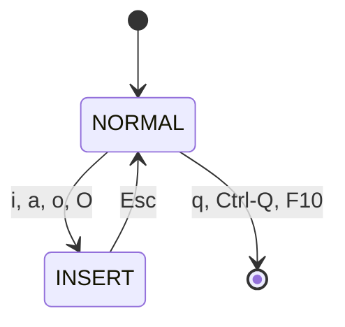
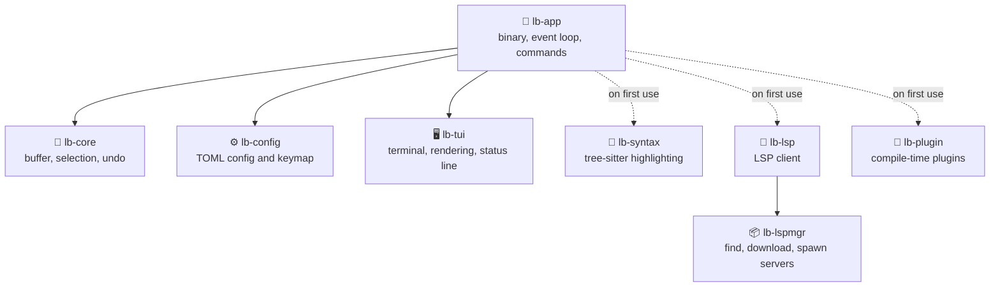

# 🐦 luckybird


**A tiny, fast terminal code editor written in Rust.** luckybird is keyboard-driven and vim-flavored, with tree-sitter highlighting and language-server support, and its release binary is under 1 MB.

Heavy features load lazily. Syntax highlighting and language servers start only when you open a file that needs them, so startup stays fast.

---

## ✨ Features

| | Feature |
|---|---|
| ⌨️ | **Modal editing.** Normal and Insert modes with vim-style keys, plus arrow keys and `Ctrl` chords that work in any mode. |
| 🎨 | **Syntax highlighting** with tree-sitter for about 30 languages. Grammars are built on demand from the actions menu. |
| 🧠 | **Language servers (LSP)** for about 30 servers, including rust-analyzer, pyright, gopls, clangd and typescript-language-server. Install them from the actions menu. |
| 🔎 | **Actions menu.** `Ctrl-Space` or `F1` opens a searchable list for save as, open, installers and quit. |
| ✂️ | **Fast text engine.** Rope-based buffers (ropey) with undo and redo. |
| 🔧 | **Configurable.** Keybindings, tab size, line numbers, scroll offset and LSP behavior live in one TOML file. |
| 🔌 | **Compile-time plugins.** Plugins are linked into the binary, so they cost nothing at startup. |
| 🔒 | **Safe downloads.** Language-server downloads are verified before they run. |

### 🎯 Design budgets

| Budget | Target |
|---|---|
| 📦 Release binary | under 1 MB today (hard limit 8 MB) |
| ⚡ Cold start to first paint | 30 ms or less |
| 🧠 Idle memory (one empty buffer) | 30 MB or less |

---

## 🚀 Quick start

```bash
git clone https://github.com/sahuishan01/luckybird.git
cd luckybird
cargo build --release -p lb-app
./target/release/luckybird path/to/file.rs
```

On Windows the binary is `target\release\luckybird.exe`.

```bash
luckybird                    # empty scratch buffer
luckybird src/main.rs        # open a file (a new name is created on save)
luckybird a.rs b.rs          # open several files
luckybird --headless         # no UI, for smoke tests and scripting
luckybird --help
```

Requires a stable Rust toolchain (2024 edition) and a C compiler, because the vendored tree-sitter core is built from C.

---

## ⌨️ Keys at a glance

luckybird starts in **NORMAL** mode, and the current mode is shown on the left of the status line.



| Keys | Action |
|---|---|
| `h` `j` `k` `l` | ⬅️⬇️⬆️➡️ Move |
| `w` / `b` | Word forward / backward |
| `0` / `$` | Start / end of line |
| `i` `a` `o` `O` | ✏️ Enter Insert mode (at cursor, after cursor, new line below, new line above) |
| `x` | Delete the character under the cursor |
| `u` / `Ctrl-r` | ↩️ Undo / redo (`Ctrl-Z` and `Ctrl-Y` work in any mode) |
| `Ctrl-S` | 💾 Save |
| `F5` | 🔄 Reload from disk |
| `Ctrl-Space` or `F1` | 🔎 Actions menu |
| `q` or `Ctrl-Q` | 🚪 Quit (asks first if there are unsaved changes) |
| `F10` | Force quit |

Some chords (file picker, command palette, search, clipboard, multiple buffers) are reserved but not implemented yet. They show "not yet implemented" in the status bar. See [SHORTCUTS.md](SHORTCUTS.md) for the full list, chord syntax and the actions menu.

---

## 🔧 Configuration

luckybird reads `~/.config/luckybird/config.toml` on Linux and macOS, and `%APPDATA%\luckybird\config.toml` on Windows. Your entries override the defaults one by one, so you only write what you change.

```toml
[keys]
"normal:H"      = "move_line_start"   # only in Normal mode
"normal:L"      = "move_line_end"
"insert:ctrl-j" = "insert_newline"    # only in Insert mode
"f12"           = "hover"             # any mode
```

Other sections cover `[editor]` (line numbers, tab size, `expand_tabs`, `auto_save`, `scroll_off`, `wrap`), `[lsp]` (`auto_install` set to prompt, always or never, plus per-language server overrides) and the theme.

---

## 🧩 Syntax highlighting and language servers

Open the actions menu with `Ctrl-Space` or `F1`:

- **Install syntax highlighting...** pick a language and its tree-sitter grammar is built from source. This needs `git` and a C compiler, but not the `tree-sitter` CLI.
- **Install language server...** pick a language and the server is installed with `rustup`, `npm`, `go` or `cargo`, depending on the server.

Installs run in the background and report progress in the status line. Reopen the file afterwards to get highlighting.

**Grammars:** Rust, Python, JavaScript, TypeScript, TSX, Go, C, C++, Java, C#, Ruby, Lua, Bash, Fish, HTML, CSS, JSON, YAML, TOML, Markdown, SQL, Dockerfile, Swift, Kotlin, Scala, Haskell, Elixir, Erlang, OCaml, Zig.

**Language servers:** rust-analyzer, pyright, typescript-language-server, gopls, clangd, jdtls, OmniSharp, ruby-lsp, lua-language-server, bash-language-server, the VS Code HTML/CSS/JSON servers, yaml-language-server, taplo, marksman, sourcekit-lsp, kotlin-language-server, metals, hls, elixir-ls, erlang-ls, ocamllsp, zls, terraform-ls, docker-langserver, tailwindcss, svelte, phpactor and nil.

---

## 🏗️ Architecture

luckybird is a Cargo workspace of small crates. Only the first three load at startup.



| Crate | Role |
|---|---|
| `lb-core` | Rope-based buffers, selections, encoding, undo and redo |
| `lb-config` | Config schema, loading, key chord parsing and defaults |
| `lb-tui` | Terminal handling, rendering, overlays and the status line |
| `lb-syntax` | Grammar loading and tree-sitter highlighting |
| `lb-lsp` | LSP client and transport |
| `lb-lspmgr` | Server registry, verified downloads, resolution and spawning |
| `lb-plugin` | Plugin trait, key bindings and event hooks |
| `lb-app` | The `luckybird` binary |

`vendor/tree-sitter` is a patched copy of tree-sitter 0.25.10 that uses `regex-lite` to save about 400 KB.

---

## 🛠️ Development

```bash
cargo build -p lb-app           # debug build
cargo test --workspace          # run all tests
cargo test -p lb-core           # one crate
```

Packaging recipes (MSI, deb, rpm, musl, macOS bundle, cross builds and a release workflow) are in [BUILD.md](BUILD.md). Project rules, per-crate notes and the change log are in [CORE.md](CORE.md), [docs/agents/](docs/agents) and [CHANGES.md](CHANGES.md). `scripts/install-grammars.ps1` is a Windows helper for building grammars by hand.

---

## 📄 License

MIT
